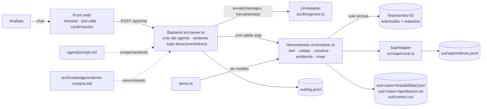

# Solución — Reto 03 · Agente "Órdenes de Compra SAP"

## 1. Problema en una frase
La analista administrativa digita a mano en SAP cada OC (proveedor, centro de costo, valor, IVA, aprobador, pago) y verifica de memoria que el aprobador tenga autoridad, lo que genera errores, controles débiles y OC retroactivas que nadie mide; le duele a la analista, a contabilidad/auditoría y a la dirección.

## 2. Arquitectura

- **Comportamiento**: `agent/prompt.md`. **Conocimiento**: `src/knowledge/ordenes-compra.md`. **Ejecución**: `src/tools/oc.ts`.
- Las herramientas no dependen del servidor: `demo.ts` las importa directamente.

## 3. Ciclo del agente
`src/server.ts`: por turno, envía historial + herramientas al modelo; ejecuta cada tool call (args validados con `zod`, resultado registrado en `out/log.jsonl`) y repite hasta que el modelo responda sin llamadas o se alcance `MAX_ITERATIONS` (25). Hay tope de tokens por sesión (`SESSION_TOKEN_LIMIT`).
**Confirmación humana**: el prompt obliga a cerrar el turno con una pregunta y la marca `[CONFIRMACION_REQUERIDA]`; el front lo resalta. Además, `oc_crear` no crea si hay confirmaciones y `confirmado !== true`, aunque el modelo se equivoque.

## 4. Elección del modelo
Google Gemini (`@google/genai`), modelo configurable con `GEMINI_MODEL`. Razones: buen soporte de function calling, latencia baja y costo bajo. Costo por caso: la prueba real de sol-001 por `/api/chat` consumió 57.281 tokens totales en un turno (no se guardó la división entrada/salida). A la tarifa de pago de USD 1,50 por 1M de tokens de entrada y USD 7,50 por 1M de salida, eso queda entre ~USD 0,09 y ~USD 0,43 por caso; en el nivel gratuito, USD 0.

## 5. Matriz de controles (RC1–RC10)
Implementada en `validarPaquete()` (`src/tools/oc.ts`), función pura sobre paquete + maestros. Cada hallazgo es `{ codigo, detalle, accion_sugerida }`.

| Regla | Tipo | Implementación |
|---|---|---|
| RC1 | Bloqueo | NIT normalizado (sin puntos ni DV); si no hay NIT, nombre normalizado (sin tildes/puntuación). Debe estar `activo`. |
| RC2 | Bloqueo | Aprobación existe, contiene "Aprobado" y `de` está en `aprobadores` del centro. Indica en qué otros centros sí aprueba. |
| RC3 | Bloqueo | `valor_total ≤ tope` del aprobador; si el aprobador no pertenece al centro, se compara con el tope máximo del centro. |
| RC4 | Bloqueo | Centro existe y la subárea pertenece a él. |
| RC5 | Confirmación | Diferencia > 2 % (aritmética exacta `dif·100 > 2·total`), o sin cotización, o monedas distintas. Muestra ambos valores. |
| RC6 | Confirmación + derivado | IVA ausente → `indicador_iva_default` del proveedor. |
| RC7 | Derivado | Condiciones de pago ausentes → `condiciones_pago_default`. |
| RC8 | Confirmación | Factura con fecha < `fecha_solicitud` → `retroactiva = true` (queda en `control.csv`). |
| RC9 | Confirmación | Fecha de aprobación < fecha de solicitud. |
| RC10 | Bloqueo | `|cantidad × valor_unitario − valor_total| ≤ 1`. |

Resultado con los fixtures: sol-001 OC directa; sol-002 bloqueada (RC1); sol-003 bloqueada (RC2, RC3); sol-004 confirmación RC5 (25.000.000 vs 26.500.000, 6 %); sol-005 confirmación RC8 (retroactiva); sol-006 confirmación RC6 + derivados C1/Z030.
**La más difícil**: RC3 en sol-003, porque el aprobador no pertenece al centro; se resolvió reportando RC2 (aprobador equivocado) y RC3 solo si ningún aprobador del centro cubre el monto, para no duplicar el mismo motivo.

## 6. Diseño del adaptador SAP real
- **Opción**: OData `API_PURCHASEORDER_PROCESS_SRV` (S/4HANA) vía SAP Integration Suite/API Management. Es estándar, REST, auditable y no requiere librerías RFC; BAPI `BAPI_PO_CREATE1` queda como alternativa en ECC.
- **Mapeo**: `proveedor.codigo_sap → Supplier`, `sociedad → CompanyCode`, `organizacion_compras → PurchasingOrganization`, `condiciones_pago → PaymentTerms`, `moneda → DocumentCurrency`; cada posición → `to_PurchaseOrderItem` (`PurchaseOrderItem`, `PurchaseOrderItemText`, `OrderQuantity`, `PurchaseOrderQuantityUnit`, `NetPriceAmount`, `TaxCode`) con imputación `K` en `to_AccountAssignment` (`CostCenter`); `referencia.solicitud_id → PurchasingDocumentExternalReference` o un campo Z; la evidencia se adjunta con el servicio de adjuntos (GOS / `API_CV_ATTACHMENT_SRV`).
- **Autenticación**: OAuth2 client credentials o certificado X.509 contra un usuario técnico; secretos en un vault (Azure Key Vault / BTP Credential Store), solo en el backend, nunca en el prompt ni en el agente.
- **Idempotencia**: antes de crear, buscar por referencia externa (`buscarOrdenPorReferencia`); en reintentos ante timeout, volver a buscar antes de recrear. Si SAP crea la cabecera pero falla un adjunto (error parcial), se registra la OC con estado `evidencia_pendiente` y se reintenta solo el adjunto.
- **Plan B**: si no hay conexión, el agente genera la OC validada lista para pegar (tabla con los campos de SAP GUI) y/o un archivo de carga masiva (CSV/LSMW) más la evidencia; la analista solo revisa y carga.

## 7. Lectura del proceso
sol-005 muestra el patrón: la factura llegó el 2026-08-10 y la solicitud se creó el 2026-08-27, con una cotización del 2026-08-05; la aprobación dice "Ya llegó la factura, por favor crear la OC". La OC se usa para legalizar el gasto, no para autorizarlo, por lo que el control de aprobación y de presupuesto llega tarde. Recomendación a la dirección: (1) medir el % de OC retroactivas por centro y proveedor con `out/control.csv`; (2) exigir OC antes de la factura para proveedores recurrentes ("no PO, no pay": tesorería no paga facturas sin OC previa); (3) para gastos recurrentes (papelería, licencias), usar contratos marco/OC abiertas para que la compra no dependa de un trámite por factura.

## 8. Decisiones y trade-offs
1. **`oc_crear` acepta `payload: null`** para registrar intentos bloqueados (sol-002 no tiene proveedor en el maestro, así que no hay payload válido). *Descartado*: dejar `payload` obligatorio como en el PRD, porque esos intentos no quedarían en `control.csv`.
2. **`oc_crear` relee el caso desde fixtures**, recalcula validación y payload, y rechaza un payload distinto (registra `rechazada`). *Descartado*: confiar en el payload del modelo; el riesgo "el modelo arregla un monto" queda cerrado por diseño.
3. **Tres fuentes de trazabilidad extra (`correo`, `aprobacion`, `constante`)** además de `solicitud`, `cotizacion`, `maestro.<nombre>` y `derivado`. *Descartado*: forzar `correo_id`, aprobador y sociedad en las cuatro etiquetas, porque sería inexacto.
4. **Unidad de medida inferida de la descripción** ("100 horas" → `H`, "N meses" con N = cantidad → `MES`, si no `UN`), documentada en la trazabilidad. *Descartado*: inventar un campo de unidad en la solicitud.
5. **Dependencias mínimas** (`zod`, `@google/genai`, `node:http`, HTML plano). *Descartado*: Express/React, por superficie y tiempo de arranque.
6. **Evidencia determinista** (sin timestamps en `aprobacion.txt`), así el `sha256` es estable entre ejecuciones y verificable.

## 9. Supuestos
- `oc_crear` acepta `payload: null` solo para dejar registrado el intento; nunca crea sin payload.
- La unidad de medida se infiere de la descripción porque la solicitud no la trae; por defecto `UN`.
- La trazabilidad usa además las fuentes `correo`, `aprobacion` y `constante`.
- `oc_crear` toma los fixtures como fuente de verdad y rechaza cualquier payload que difiera.
- Los montos se usan exactos desde la solicitud (`valor_unitario`, `valor_total`); los precios de los fixtures son IVA incluido según la cotización y no se recalcula la base neta, para no introducir redondeos.
- La OC se crea por el valor de la solicitud (lo aprobado), no por el de la cotización, aunque se confirme RC5.
- La descripción de la posición se trunca a 40 caracteres (texto breve SAP); el original queda en la trazabilidad.
- `confirmado_por` registra la sesión que confirmó (`sesion:<id>`), ya que no hay autenticación.
- Idempotencia por `solicitud_id` (`SOL-2026-00X`), no por nombre de carpeta del caso.

## 10. Cobertura
| Historia | Estado | Falta para producción |
|---|---|---|
| HU-1 Leer paquete | Hecho | Leer `.xlsx`/`.pdf`/`.eml` reales (P1). |
| HU-2 Validar | Hecho | Maestros en tiempo real desde SAP. |
| HU-3 Payload + trazabilidad | Hecho | Varias posiciones por OC. |
| HU-4 Evidencia | Parcial | P0 `aprobacion.txt` + sha256 hecho; P1 PDF no hecho. |
| HU-5 Crear OC | Hecho | Adaptador SAP real; lock entre procesos (hoy solo en proceso). |
| HU-6 Errores | Hecho | Todas las herramientas devuelven `{ ok:false, error }` sin lanzar. |
| Link público | Pendiente | Despliegue. |
| Bonus módulo | No hecho | — |

## 11. Uso de IA
- **Claude Code (Anthropic)**: lectura del PRD y de los fixtures, implementación de `oc_validar`, `oc_construir_payload`, `oc_generar_evidencia`, `oc_crear`, `MockSapAdapter`, `demo.ts` y este documento. Detectó que el parser original no leía `TOTAL (IVA incluido):` ni el número de factura, y que marcaba los adjuntos binarios como faltantes.
- **Asistente de IA (scaffolding inicial)**: estructura del repo, esquemas zod, servidor, adaptador Gemini y front.
- **Descartado**: placeholders con valores inventados en `demo.ts` (proveedor "PENDIENTE", montos 0); valores derivados de la cotización para "cuadrar" montos; recalcular precios netos sin IVA (introduciría redondeos).

## 12. Riesgos
- **Conexión SAP no viable** → Plan B (sección 6).
- **Modelo altera montos** → `oc_crear` recompone desde fixtures y rechaza diferencias.
- **Precio bruto vs neto con IVA**: los fixtures traen precio IVA incluido; en SAP real hay que definir si se envía neto + `TaxCode` o bruto, o se duplica el IVA.
- **Concurrencia**: el lock es en proceso; con varias instancias haría falta un lock distribuido o la idempotencia de SAP.
- **Fuga de claves** → clave solo en `.env` (ignorado por git), nunca en front, logs ni respuestas.
- **Costo** → tope de iteraciones y de tokens por sesión.
